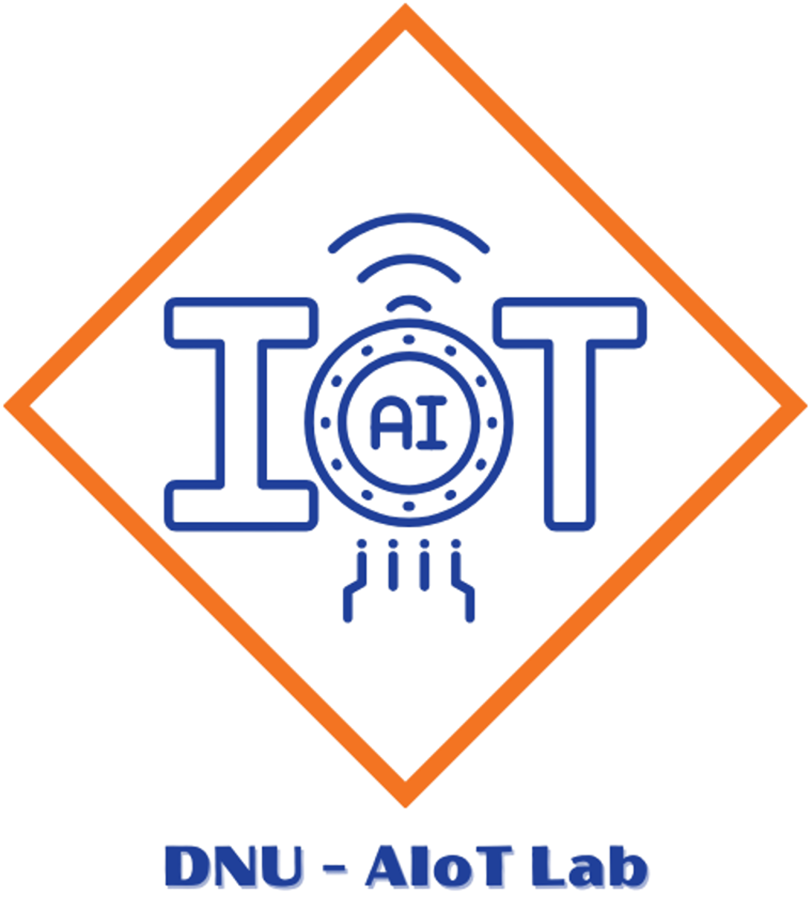

<h2 align="center">
    <a href="https://dainam.edu.vn/vi/khoa-cong-nghe-thong-tin">
    🎓 Trường Đại học Đại Nam — Khoa Công nghệ Thông tin
    </a>
</h2>
<h2 align="center">
    BÀI THỰC HÀNH PHÁT TRIỂN PHẦN MỀM MÃ NGUỒN MỞ (PTPMMNM)
</h2>

<div align="center">
    <p align="center">
        
        
        
    </p>

[](https://www.facebook.com/DNUAIoTLab)
[](https://dainam.edu.vn/vi/khoa-cong-nghe-thong-tin)
[](https://dainam.edu.vn)

</div>

---

## 👥 1. Thông tin nhóm thực hiện

- **Lớp**: CNTT 18-10
- **Nhóm**: Nhóm 10
- **Dự án**: CommunityPass — Phần mềm đăng ký tham dự sự kiện (PHP Native)

| STT | Họ và tên | Mã sinh viên | Vai trò |
| :---: | :--- | :---: | :--- |
| 1 | **Nguyễn Văn An** | `1871020003` | Thành viên |
| 2 | **Lê Đình Huy** | `1871020307` | Thành viên |
| 3 | **Đào Thị Tươi** | `1871020639` | Trưởng nhóm |

---

## 📋 2. Kế hoạch và Tiến độ thực hiện 5 Lab

| Bài Lab | Nội dung | Trạng thái | Nhánh Git |
| :---: | :--- | :---: | :---: |
| **Lab01** | Linux và Shell Script (`check-env.sh`, `scan-source.sh`) | Hoàn thành | [feature/lab1](https://github.com/annguyen0708/PTPMMNM-CNTT-1810-NHOM-10/tree/feature/lab1) |
| **Lab02** | Module PHP kiểm tra điều kiện đăng ký | Hoàn thành | [feature/lab2](https://github.com/annguyen0708/PTPMMNM-CNTT-1810-NHOM-10/tree/feature/lab2) |
| **Lab03** | Hiển thị sự kiện, lọc đa tiêu chí, xử lý form POST | Hoàn thành | [feature/lab3](https://github.com/annguyen0708/PTPMMNM-CNTT-1810-NHOM-10/tree/feature/lab3) |
| **Lab04** | Bản nháp bằng Session và Cookie | Hoàn thành | [feature/lab4](https://github.com/annguyen0708/PTPMMNM-CNTT-1810-NHOM-10/tree/feature/lab4) |
| **Lab05** | Cơ sở dữ liệu PostgreSQL (Lưu, truy vấn, thống kê) | Hoàn thành | [feature/lab5](https://github.com/annguyen0708/PTPMMNM-CNTT-1810-NHOM-10/tree/feature/lab5) |

---

## 💻 3. Chuẩn bị môi trường (Ubuntu / WSL)

Hệ thống yêu cầu chạy trên môi trường Linux (Ubuntu 22.04 / 24.04 trên WSL2), sử dụng **PHP từ 8.1 trở lên** và **Git**:

```bash
# Cập nhật package và cài đặt công cụ cần thiết
sudo apt update
sudo apt install -y php-cli git unzip curl

# Kiểm tra phiên bản
php -v
git --version
```

### Chạy từng bài Lab
Mỗi bài lab được phát triển trên nhánh riêng biệt `feature/labN` và đặt trong thư mục `labN/`:
```bash
# Chuyển nhánh thực hành
git checkout feature/lab<N>

# Di chuyển vào thư mục mã nguồn bài lab
cd lab<N>/Ma_nguon

# Kiểm tra môi trường và chạy thử
bash lab.sh check
bash lab.sh run
```

---

## 📚 4. Tham chiếu tài liệu gốc

- Repository đề bài: [FIT-DNU/Open-Source-Software-Development](https://github.com/FIT-DNU/Open-Source-Software-Development)
- Thiết kế hệ thống: [CommunityPass Design Doc](docs/communitypass/DESIGN.md)
- Phạm vi sản phẩm: [CommunityPass Product Boundaries](docs/communitypass/PRODUCT.md)
